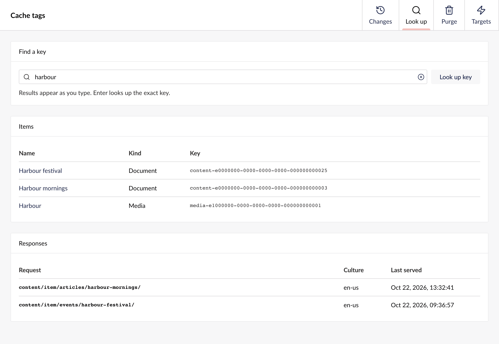

Administrators find the package under **Settings > Advanced > Cache tags**, and in a **Cache** box on every document's and media item's **Info** tab.

## Changes

<Frame caption="A publish of Harbour mornings, with the keys it planned, the server that applied and indexed it, and its two purges.">

</Frame>

Changes lists the latest changes, newest first. Open one to see:

- The item and listing keys it planned
- How many recorded responses the plan reaches now
- Which servers applied it, and which servers' indexes have it
- Its purges to each target, with their attempts and any error

A change shows **Waiting for servers** until every server has applied it, then **Waiting for index** until every server's index has it, then **Purged** once its purges are queued or sent. The view refreshes itself until the change is purged.

Purges that failed their last attempt are listed at the top. **Retry** sends one again once the target answers, and **Set aside** hides it.

## Look up

<Frame caption="Searching for harbour finds items by name, and recorded responses by their request.">

</Frame>

Search by an item's name, or by part of a path, a query or a key. Then open a result:

- A document or media item shows the responses that include it.
- A `response-` key shows its request, culture, when it was rendered and last served, and every key it covers.
- Any other key shows the responses that cover it.

Searches and other catch-all listings carry their keys in their own header, and the package does not record them, so Look up cannot find them.

## Purge

Purge keys by hand, one per line, or purge everything. After you purge everything, every cached response is fetched again from Umbraco, so expect more load for a while.

## Targets

Add a webhook, a Cloudflare zone or a target type you registered, send it a test purge before you save, and edit, disable or remove it later. The tab lists targets from `appsettings.json` too, read-only. See [Purge targets](/targets#in-the-backoffice).

## The Info tab

A document's or media item's **Info** tab has a **Cache** box. It shows how many served responses include the item, lists the first five, links to the rest in Look up, and has **Purge this item**.

<Frame caption="The Cache box on Harbour mornings' Info tab.">

</Frame>

The list is what the package has recorded, not what a cache holds right now. A purge doesn't empty it, because the next render of each response includes the item again.
