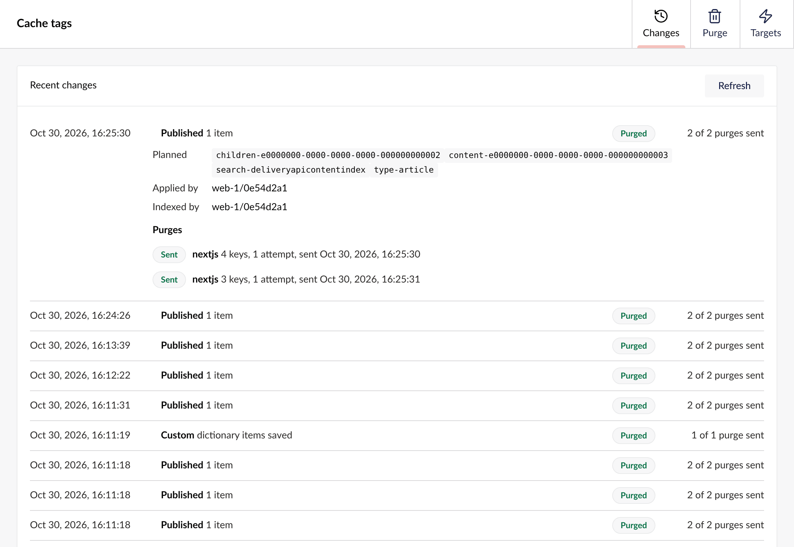
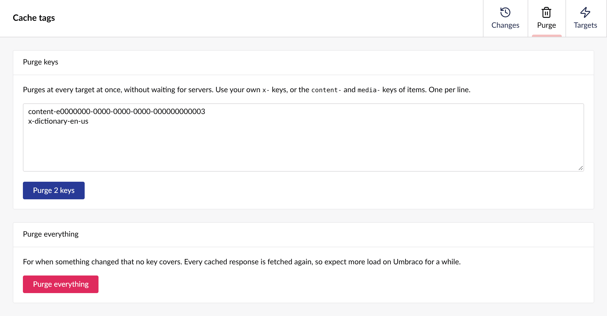
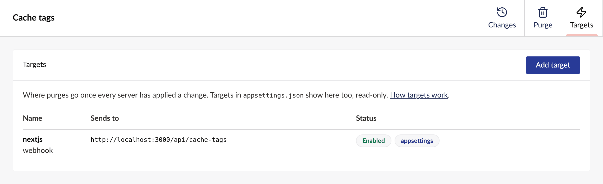
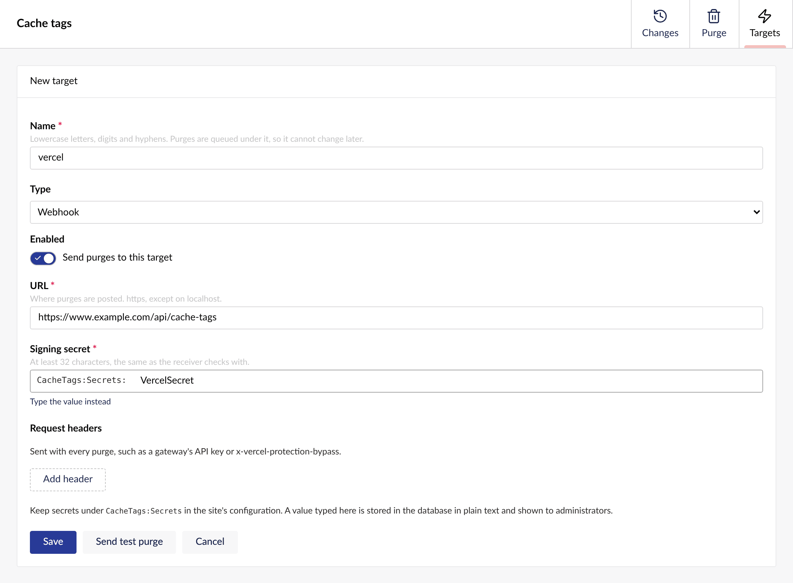
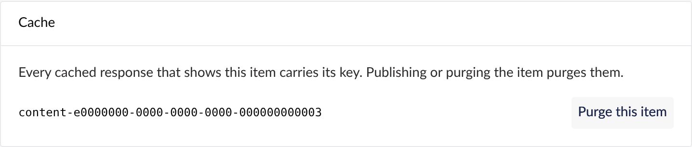

Administrators find the package under **Settings > Advanced > Cache tags**, with three tabs: **Changes**, **Purge** and **Targets**. Every document and media item also gets a **Cache** box on its **Info** tab.

## Changes

<Frame caption="A publish of Harbour mornings, with the keys it planned, the server that applied and indexed it, and its two purges.">

</Frame>

Changes lists the latest changes, newest first. Open one to see the keys it planned, which servers applied it and have it in their index, and each purge with its attempts and any error.

| Status | Means |
| --- | --- |
| **Waiting for servers** | A server has not applied the change yet. |
| **Waiting for index** | Every server has applied it, but a server's index has not caught up. |
| **Purged** | Its purges are queued or sent. |

The view refreshes itself until the change is purged. [How a purge is timed](/timing) explains each stage.

:::note
Purges that failed their last attempt are listed at the top, and stay until you act on them. **Retry** sends one again once the target answers, and **Set aside** hides it.
:::

## Purge

<Frame caption="Two keys typed in: an item's own key and a site's x- key.">

</Frame>

Purge keys by hand, one per line. You can purge your own `x-` keys, items' `content-` and `media-` keys, and `umbraco` for everything. Purging an item's key purges its type's listings too, so a long listing that shows the item is reached.

:::caution
After **Purge everything**, every cached response is fetched again from Umbraco, so expect more load for a while.
:::

## Targets

<Frame caption="The sample's Next.js webhook, from appsettings.json, so it is read-only here.">

</Frame>

The tab lists every target, those from `appsettings.json` too, read-only. **Add target** opens the form below. Edit, test, disable or remove a target you added here at any time.

<Frame caption="A new webhook target, with its signing secret read from configuration.">

</Frame>

**Send test purge** checks the target answers before you save. Keep secrets under `CacheTags:Secrets` in the site's configuration rather than typing them in. See [Purge targets](/targets#in-the-backoffice).

## The Info tab

<Frame caption="The Cache box on Harbour mornings' Info tab.">

</Frame>

A document's or media item's **Info** tab has a **Cache** box with the item's key and **Purge this item**. Every cached response that shows the item carries that key, so publishing or purging the item reaches each of them.
