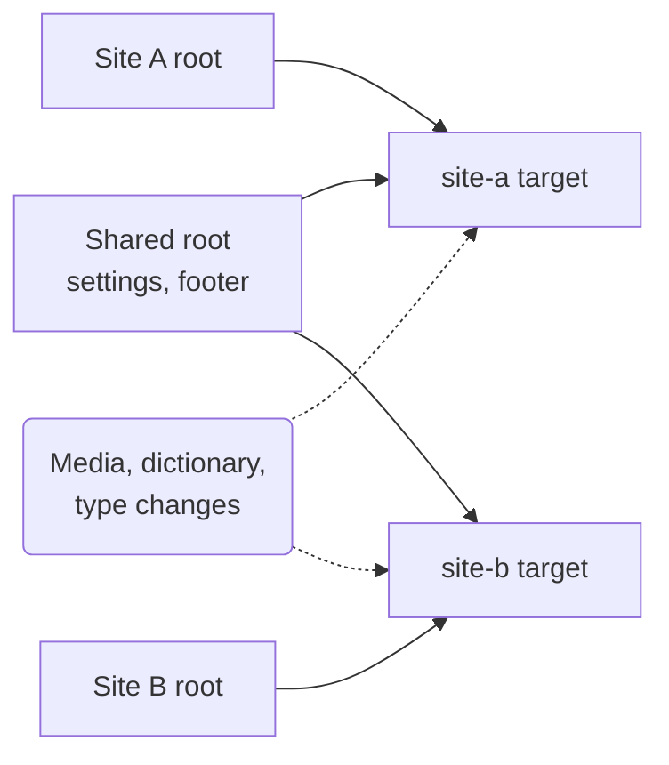

A target is where the package sends purges. Add targets in the backoffice under **Settings > Advanced > Cache tags > Targets**, or by name under `CacheTags:Targets` in `appsettings.json`. The built-in types are `webhook`, the default, which posts a [signed request](/webhook) to your frontend, and [`cloudflare`](/cloudflare). You can register your own.

```json appsettings.json
{
  "CacheTags": {
    "Targets": {
      "nextjs": { "Url": "https://www.example.com/api/cache-tags", "Secret": "<at least 32 characters>" },
      "cdn": {
        "Type": "cloudflare",
        "Settings": { "ZoneId": "<zone id>", "ApiToken": "<token>" }
      }
    }
  }
}
```

Every target gets every purge, unless it is limited to some site roots (see [Several sites](#several-sites)). Set `"Enabled": false` to pause a target without removing it.

## In the backoffice

Administrators add, edit, test and remove targets under **Settings > Advanced > Cache tags > Targets**. The tab also lists the targets in `appsettings.json`, read-only and without their secrets or header values.

Each value, whether the signing secret, a header or a Cloudflare token, is either typed in or names a secret under `CacheTags:Secrets` in the site's configuration. The package reads a named secret when it sends a purge.

<CodeGroup>
```json appsettings.json
{
  "CacheTags": {
    "Secrets": {
      "VercelSecret": "<at least 32 characters>",
      "VercelBypass": "<bypass secret>"
    }
  }
}
```

```sh Environment variables
CacheTags__Secrets__VercelSecret=<at least 32 characters>
CacheTags__Secrets__VercelBypass=<bypass secret>
```
</CodeGroup>

A target that names `VercelBypass` reads `CacheTags:Secrets:VercelBypass`, and nothing outside that section. A secret's name uses letters, digits and underscores, so it can always be set as an environment variable. So an administrator can send a target only the values you put under `CacheTags:Secrets`, never the database connection string or other settings.

:::caution[Keep secrets out of the database]
The package stores a typed value in the database in plain text, and shows it to administrators. Put secrets under `CacheTags:Secrets`, ideally as environment variables or in your host's secret store, and name them instead.
:::

- **A missing secret fails the purge, not the save.** If a secret that a target names is not set on a server, the target shows a problem. Its purges from that server fail with an error that names the header or signing secret, never the secret's name. The package retries them with backoff, up to 10 tries over about 17 minutes, and then lists them under **Failed purges**, where **Retry** sends them again once the secret is deployed.
- **Send test purge** sends the target a purge of `x-cache-tags-test`, a key nothing carries, and says whether the target accepted it. It works before you save.
- **The name never changes**, because the package queues purges under it. Deleting a target sets its unsent purges aside.
- **A name in `appsettings.json` wins.** The package ignores a backoffice target with the same name, and logs a warning.
- **Other servers** pick up a change to a target within 5 seconds.

### Public addresses only

A backoffice target can only connect to public internet addresses, so an administrator cannot point one at a service inside your network. Set `CacheTags:AllowPrivateNetworkTargets` to `true` to allow private addresses, such as `localhost` in development.

The limit doesn't apply to targets in `appsettings.json`, or to target types you register, which make their own requests.

To check the address it connects to, a backoffice target connects directly, not through `HTTPS_PROXY` or the system proxy, unless `AllowPrivateNetworkTargets` is on. If your site reaches the internet only through a proxy, configure its targets in `appsettings.json`, which use the proxy as usual.

## Several sites

When one Umbraco serves several sites, each with its own root and frontend, limit each site's target to the roots it shows. A root is a document at the top of the content tree.



A change under Site A reaches only the site-a target, and a change under the shared root reaches both, because both list it. Media, the [dictionary and your own keys](/your-apis), type changes and site-wide changes go to every target, since any site may show them. A target with no roots gets every change.

```json appsettings.json
"site-a": {
  "Url": "https://site-a.example.com/api/cache-tags",
  "Secret": "<at least 32 characters>",
  "Roots": [
    "e0000000-0000-0000-0000-000000000001",
    "e0000000-0000-0000-0000-000000000300"
  ]
}
```

:::caution[List every root the site shows]
A target only gets changes under the roots it lists. If the site also shows content from another root, such as a shared settings or footer root, or a page picked from another site, list that root too. Otherwise changes to that content never reach the frontend, and it keeps serving the old content without any error.
:::

In the backoffice, pick the roots in a target's **Site roots** field. A target from `appsettings.json` has an **Edit roots** button for the same, unless `appsettings.json` sets its `Roots`. The package keeps those roots in the database, so every server uses them.

## Request headers

A webhook can send its own headers with every purge, such as a gateway's API key, or `x-vercel-protection-bypass` for a protected Vercel deployment:

```json appsettings.json
"nextjs": {
  "Url": "https://www.example.com/api/cache-tags",
  "Secret": "<at least 32 characters>",
  "Headers": { "x-vercel-protection-bypass": "<bypass secret>" }
}
```

A target sends at most 20 headers, each value on one line. The package refuses headers it sets itself, such as `Host`, `Content-Type`, `User-Agent` and the signature headers. The signature, not a header, proves that a purge came from Umbraco.

## Your own target

Implement `IPurgeTarget` for another CDN or cache, and register it as a singleton:

```csharp
public sealed class FastlyTarget(IHttpClientFactory http) : IPurgeTarget
{
    public string Type => "fastly";

    public async Task<string?> SendAsync(PurgeRequest request, CacheTagsTargetOptions target, CancellationToken cancellationToken)
    {
        var keys = request.Expire.Concat(request.Stale);
        // Send the keys with target.Settings["ServiceId"] and target.Settings["ApiToken"].
        // Return null on success, or what went wrong, and the package retries with backoff.
        return null;
    }
}

builder.Services.AddSingleton<IPurgeTarget, FastlyTarget>();
```

Then configure a target with `"Type": "fastly"` and its `Settings`, in `appsettings.json` or the backoffice. The target's `Headers` are available too, if your type uses them.
