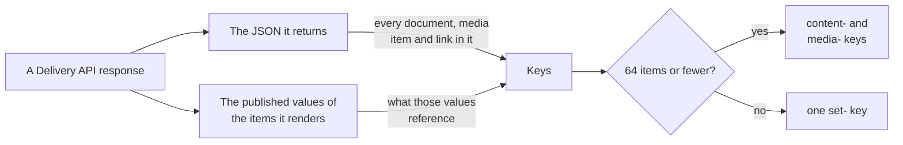
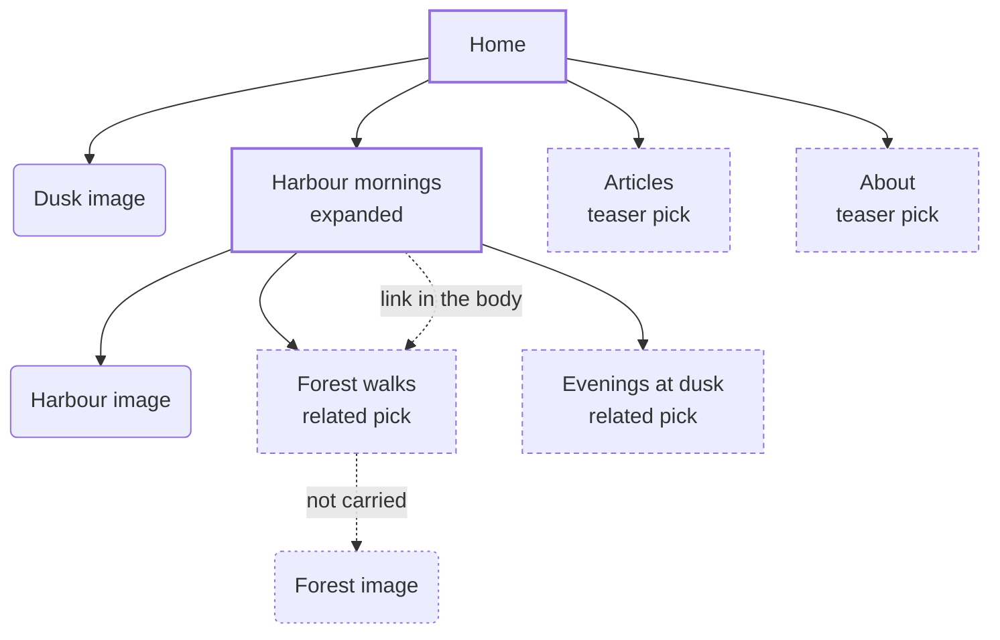
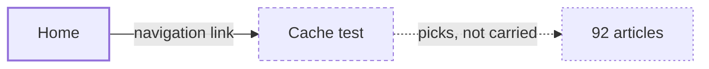

A response carries the key of every document and media item it shows. An item it renders with its properties also brings the keys of what those properties reference. An item it only names, such as a link or a pick that isn't expanded, brings its own key and nothing more.

## Two sources



The JSON is what a reader sees: the item, the media it uses, the documents it picks and the links in it, at any depth of blocks and rich text.

The published values cover what the JSON can't name. A pick of an item that isn't published yet renders as nothing, but the response still has to change when that item is published. So for each item the response renders with its properties, the package reads what its published values reference, the same way Umbraco finds relations. Those are source values, which Umbraco never caches away, so a warm request carries the same keys as a cold one.

## A worked example

The sample site's home page has a hero image (Dusk), a featured article (Harbour mornings) and two teaser blocks that pick Articles and About. Harbour mornings has its own image, picks two related articles, and links Forest walks in its body.

Asked for with `?expand=properties[featuredArticle]`, the response renders Home and Harbour mornings with their properties. Everything else is only named:



The heavy boxes are rendered with their properties, so what they reference counts. The dashed boxes are only named, so only their own key counts, and the rounded boxes are media. Forest walks' image is not carried, because the response never shows Forest walks' properties.

Expanding more renders more, and the header grows with it:

| Request for Home | Rendered with properties | Carries, besides `umbraco` |
| --- | --- | --- |
| No `expand` | Home | Home, Dusk, Harbour mornings, Articles, About |
| `expand=properties[featuredArticle]` | Home, Harbour mornings | the above, plus Harbour image, Forest walks, Evenings at dusk |
| `expand=properties[featuredArticle[properties[related]]]` | Home, Harbour mornings, Forest walks, Evenings at dusk | the above, plus Forest image |

Each row is checked against the sample site on every change to the package, so this page stays true.

## What each value adds

| In the response | Its own key | What it references |
| --- | --- | --- |
| The item you asked for | Yes | Yes |
| A picked document, expanded | Yes | Yes, at any depth |
| A picked document, not expanded | Yes | No |
| A link, from a multi URL picker | Yes | No |
| A link in rich text | Yes | No |
| A media item | Yes | No |
| A block | No, blocks aren't published on their own | Its picks and links count as above |

## Expand

Umbraco renders a picked document with its properties only when the request expands it. `expand=properties[$all]` expands every pick one level down, and `expand=properties[$all[properties[$all]]]` two levels. The keys follow exactly what is expanded, at whatever depth.

Links never expand. Umbraco's multi URL picker and rich text ignore `expand`, so a link shows its target's name and URL however deep the request expands. A navigation that links a page picking 92 articles carries one key for that page, not 92:



Publishing one of the 92 articles doesn't purge Home, because Home never shows them. Renaming or moving Cache test does, because that changes the link.

## Rich text

A link in rich text carries its target's key, whether the Delivery API returns the rich text as HTML or as JSON. The target's URL and name are in the link, so a rename or a move has to reach the response. What the target references is not carried.

Blocks inside rich text are walked like any other block: their picks, links and media count as in the table above.

## Fields

`fields` limits which properties an expanded item shows. The keys still cover everything the item references, because the package reads the item's published values, not the fields in the JSON. With `expand=properties[featuredArticle]&fields=properties[featuredArticle[properties[title]]]`, the response shows one title, and Home still carries the same 8 keys as without `fields`: Dusk, Articles and About, and Harbour mornings' image and related articles. That is more keys than the response needs, never fewer: a publish may refresh it once too often, but never leaves it stale.

## Your own APIs

A response from your own controller with `[CacheTagged]` is collected the same way: the keys you name, then the Delivery API items in its result and what the items it renders with their properties reference. See [Your own APIs](/your-apis).

The package only recognizes Umbraco's Delivery API models in a result, as `IApiContentBuilder`, `IApiMediaBuilder` and Umbraco's value converters build them. An item in a shape of your own, such as a class holding its id or URL, isn't found. Name its key yourself:

```csharp
cacheTags.Add($"content-{article.Key:D}");
```

## Custom property editors

Nothing depends on the document type. What counts is each property's editor:

| The editor | What it adds |
| --- | --- |
| A value converter that returns Delivery API models (content, media, links, blocks, rich text) | The keys of what the JSON shows |
| A reference factory, as Umbraco's own editors have | What its published values reference |
| Neither, such as an id kept in a text field | Nothing |

An editor that holds references should give Umbraco a reference factory (`IDataValueReferenceFactory`) anyway, because Umbraco's relations and "used by" lists depend on it too.

## Too many items

Past 64 items, a response carries one `set-` key in place of its item keys, and the package stores which items the set holds. See [Limits](/keys#limits). Since a link brings only its own key, a page's count is the items it shows, so most pages stay well under the limit.
