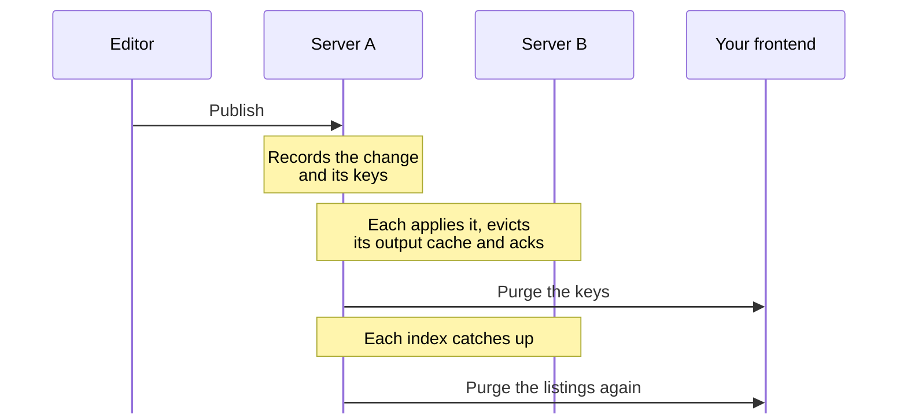

A purge sent too early is worse than none. The frontend refetches at once, gets the old content from a server that has not applied the change yet, and caches it again for days. So the package waits until every server serves the new content, and purges listings again once every server's index has caught up.

## At a glance

| What | How long |
| --- | --- |
| Heartbeat from each server | Every 30 seconds |
| A server counts as gone | 2 minutes without a heartbeat |
| Wait for every server to apply a change | At most 60 seconds |
| Wait for every server's index | At most 5 minutes |
| Keys per purge request | At most 500 |
| Retries of a failed purge | 10 attempts, after 2, 4, 8 and more seconds, at most 10 minutes apart |

The timings are fixed, and there is nothing to configure.

## The steps

<Steps>
  <Step title="Record">
    The server where the editor published records the change in the package's ledger, with the keys it plans to purge.
  </Step>
  <Step title="Acknowledge">
    When a server applies the cache refresh for the change, it evicts the change's responses from Umbraco's own output cache and acknowledges it. A refresh counts only if it carries what the change did, so a draft save does not count.
  </Step>
  <Step title="Release">
    Once every server that was running when the editor made the change has acknowledged it, the purge of the planned keys is queued for each target. After 60 seconds it is queued anyway, and the log names the servers that did not answer.
  </Step>
  <Step title="Wait for the index">
    Listings come from each server's Delivery API index, which Umbraco updates a second or two after the refresh, or over a minute right after a restart. Each server checks its index until it has the changed item, then evicts its own listing responses. Once every server has, the listing keys are purged again. After 5 minutes they are purged anyway.
  </Step>
  <Step title="Send">
    Purges go out signed, one server at a time per purge. A failed purge is retried with backoff, and after its last attempt it stays in the backoffice under **Failed purges** until someone sends it again or sets it aside.
  </Step>
</Steps>

:::note
The first purge includes listings on purpose. The items a listing shows come from the published cache, so they are fresh at once. Only which items it lists, and their order, wait for the index.
:::

## Several servers

Every server, delivery servers included, runs the same loop against the shared database. The package finds the servers by their heartbeats, so nothing needs configuring.

| When | What happens |
| --- | --- |
| A server has just started | It applies other servers' changes once Umbraco's instruction job first runs, about a minute after start. A change made in that minute waits for it, or for the 60 second timeout. |
| A server restarts after a change was purged | It counts as a new server, so the change does not wait for it. It serves its listings from the index as the index rebuilds. |
| A change was purged without a server | Once that server applies the change, it evicts it from its own output cache and sends the purge again, so the frontend refetches the new content. |

:::caution
Keep the servers' clocks in sync, as NTP does. A refresh counts for a change only within 2 seconds of it, so a server whose clock is further behind is never acknowledged in time, and its changes always wait the full 60 seconds.
:::

## What a change purges

Most changes purge the keys of the items they touch. These reach further:

| Change | Purges |
| --- | --- |
| Domain, language or public access | `umbraco`, as stale |
| Content type, media type or data type | `umbraco`, as stale, since any response may render an item of the type |
| A route change with more than 500 descendants | `umbraco`, as stale |
| Content type alias rename | `umbraco`, and again the old and new alias's listings once every index has the new alias, up to a minute later |
| Sort | The parent's `children-` listings, the sorted items' `type-` listings and every `search-` listing, once every index has the new order |

[Keys](/keys) explains what each key covers, and why some are purged as stale.
