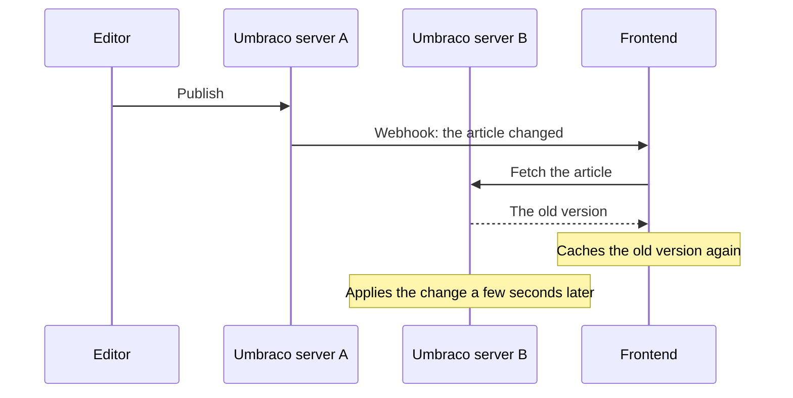
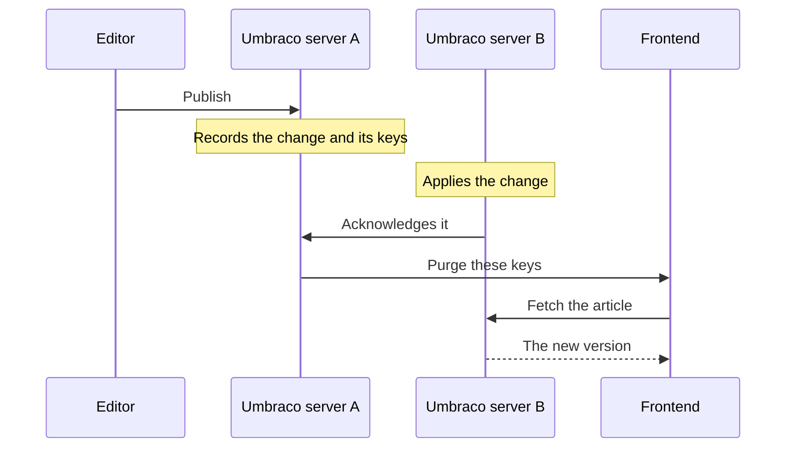

A headless frontend is fast when it serves pages from its own cache, and Umbraco does less work when the frontend rarely asks. The hard part is knowing when to throw a cached page away. Umbraco tells you that an item changed. It does not tell you which of your cached pages showed that item, or when it is safe to fetch them again.

## What Umbraco gives you

<CardGroup cols={2}>
  <Card title="Delivery API output cache" icon="database">
    Caches responses on the Umbraco server and evicts them when content changes. Your frontend and CDN cache in front of it, and never hear about the eviction.
  </Card>
  <Card title="Webhooks" icon="webhook">
    Call your frontend when an item is published, unpublished or deleted. The payload names the item. Working out which pages showed it is left to you.
  </Card>
</CardGroup>

With those two, a frontend usually picks one of three approaches.

## The usual approaches

Take one article. It has its own page, it is in the news listing, the homepage shows it as the latest news, and two other articles pick it as related. An editor fixes a typo in its title.

<Tabs>
  <Tab title="Refetch on a timer">

  
<strong>Article page</strong>Shows the typo

  
<strong>News listing</strong>Shows the typo

  
<strong>Homepage</strong>Shows the typo

  
<strong>Related article</strong>Shows the typo

  
<strong>Related article</strong>Shows the typo

  
<strong>Every other page</strong>Fetched again every 10 minutes

All five pages show the typo for up to 10 minutes. Every other page on the site is fetched again every 10 minutes too, changed or not. A shorter timer means fresher pages and more requests to Umbraco.

  </Tab>
  <Tab title="Purge everything">

  
<strong>Article page</strong>Shows the fix

  
<strong>News listing</strong>Shows the fix

  
<strong>Homepage</strong>Shows the fix

  
<strong>Related article</strong>Shows the fix

  
<strong>Related article</strong>Shows the fix

  
<strong>Every other page</strong>Rendered again on its next visit

All five pages are fresh. So is every other page, and each one is rendered again on its next visit. On a site where editors publish all day, the cache is rarely warm.

  </Tab>
  <Tab title="Purge by path">

  
<strong>Article page</strong>Shows the fix

  
<strong>News listing</strong>Shows the typo

  
<strong>Homepage</strong>Shows the typo

  
<strong>Related article</strong>Shows the typo

  
<strong>Related article</strong>Shows the typo

  
<strong>Every other page</strong>Still cached

The article page is fresh. The listing, the homepage and the two related articles keep the typo until something else purges them. Content is reused across listings, pickers, navigation and blocks, so a page's path says little about what it shows.

  </Tab>
  <Tab title="Cache Tags">

  
<strong>Article page</strong>Shows the fix

  
<strong>News listing</strong>Shows the fix

  
<strong>Homepage</strong>Shows the fix

  
<strong>Related article</strong>Shows the fix

  
<strong>Related article</strong>Shows the fix

  
<strong>Every other page</strong>Still cached

The five pages are purged, and nothing else is. The package remembers what each response showed, so it knows which pages the article reaches.

  </Tab>
</Tabs>

## A purge sent too early

Even the right purge goes wrong if it arrives before Umbraco serves the new content. The frontend fetches again at once, gets the old version, and caches it for as long as it caches anything.

<Tabs>
  <Tab title="Webhook on publish">

  </Tab>
  <Tab title="Cache Tags">

  </Tab>
</Tabs>

- **Several servers.** The webhook is sent from the server where the editor published. The other servers apply the change a few seconds later, or about a minute later if one has just started. A refetch that lands on one of them gets the old content.
- **Listings and filters.** They come from the Delivery API index, which Umbraco updates in the background a moment after the publish, even on a single server. A listing fetched at once can still miss a new article, or keep one that was unpublished.

Both cases leave stale content in the cache with nothing left to purge it. Cache Tags waits until every server serves the change, and purges listings again once every server's index has it. See [How a purge is timed](/timing).

## What Cache Tags does

<Steps>
  <Step title="Each response names what it covers">
    The Delivery API sends a key in the `X-Umbraco-Cache-Keys` header, and your frontend tags its cache entry with it. In Next.js that is one `cacheTag` call in your fetch helper.
  </Step>
  <Step title="The package records what each response showed">
    That includes the items, the items they pick, and the listings, filters and searches the response answered.
  </Step>
  <Step title="A change is planned as keys">
    A publish, move, sort, unpublish or type change becomes the keys of every response it touches, and only those.
  </Step>
  <Step title="It waits for every server">
    The purge goes out once every Umbraco server serves the change, and listings once every server's index has it.
  </Step>
  <Step title="Your frontend purges by key">
    A signed webhook calls one route in your frontend, or the package purges Cloudflare by tag.
  </Step>
</Steps>

Pages stay cached until a change reaches them, with no timer. Umbraco answers only the requests a change made necessary, and the backoffice shows each change, the servers it waited for and the purges it sent.

## When you may not need it

- **Nothing is cached.** If every page renders on each request, there is nothing to purge.
- **A few minutes of stale content is fine.** A short timer is simpler, and costs little on a site with little traffic.
- **The site is small.** Purging everything is cheap when a full rebuild takes seconds.
